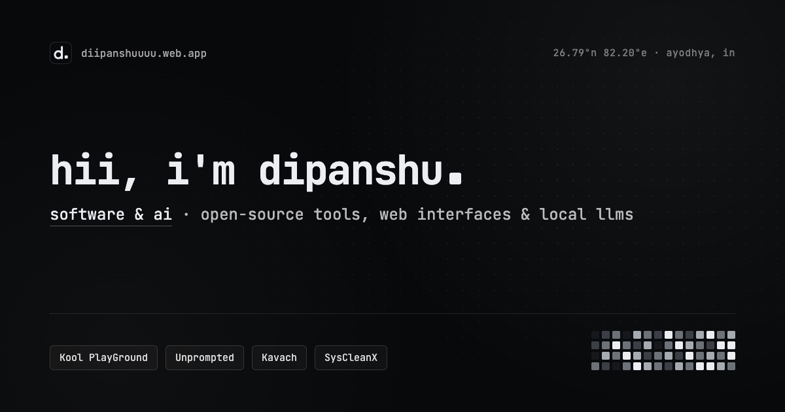

# dipanshu singh — software & ai

> **Live site**: [https://diipanshuuuu.web.app](https://diipanshuuuu.web.app)



Personal portfolio of **Dipanshu Singh**, a first-year B.Tech CSE (AI & ML) student at Newton School of Technology who builds open-source utilities, web and systems software, and local AI tools.

Built with plain HTML, CSS, and vanilla JavaScript (with a lightweight Express server for local dev and contribution/API helpers). It looks quiet, and has a few small surprises for people who poke around.

## Features

- **Minimal, monospace layout.** One column in JetBrains Mono, monochrome dark by default with a cream light theme. Switching themes grows the new one out of the toggle in a circle.
- **Subtle details:**
  - The name decrypts on load, and its letters thin out as the cursor gets close. JetBrains Mono is a variable font with fixed-width letters, so nothing shifts.
  - A faint dot grid appears only around the cursor.
  - Section titles and links scramble for a beat on hover.
  - The tagline types itself, and a live clock shows the time in Ayodhya (`26.79°n 82.20°e`).
  - Auto-hiding contribution-square page scroll indicator.
  - Clicking anywhere throws sparks.
- **GitHub contributions heatmap.** Merges contribution activity across `diipanshuuuu` and `htmnsrc` (`lib/contributions.js`) with interactive tooltips.
- **Projects & Field Notes.** Clean one-line rows, one open at a time, with lazy-loaded previews (`lib/lazy-media.js`):
  - **Websites** are embedded live and scaled down, so a new deploy shows up immediately.
  - **Apps** pull their screenshots straight from their GitHub repo (`preview.png` or `data-shots`), crossfading with dot controls.
  - **Kavach** includes an interactive local PII masking lab (`lib/kavach.js`) right inside the card.
- **Live signal from Discord.** Uses [Lanyard](https://github.com/Phineas/lanyard) (REST + WebSocket) to show live activity in `clock`, `now`, or `dot` presence modes; stays hidden if unreachable.
- **Secrets:**
  - Press `/` (or click the footer hint) to open a hidden shell. Try `help`, `map`, `goto trail`, `compass`, `neofetch`, or `sudo hire-me`.
  - The Konami code cycles the accent color.
- **Accessible:**
  - Skip link, visible focus, and full keyboard support.
  - The shell is a modal dialog that traps focus and closes on Escape.
  - Responsive down to 375px with `prefers-reduced-motion` support.

## Structure

```text
index.html            the page; all content lives here
styles.css            design tokens, layout, components, motion
script.js             theme, copy email, name effect, scramble, sparks, shell, clock, easter eggs
server.js             optional Express server for local dev and API routes
lib/                  shared modules & tests (contributions, kavach, lazy-media, reading-progress)
favicon.svg           monochrome "d" + square cursor mark
apple-touch-icon.png  180×180 home-screen icon
og-image.jpg          Open Graph / social preview image
resume.pdf            exported résumé, linked from the page
resume/resume.html    résumé source
firebase.json         Firebase Hosting config (site: diipanshuuuu)
robots.txt            crawler rules
sitemap.xml           sitemap for diipanshuuuu.web.app
design-system/        UI/UX Pro Max design notes (pages/home.md overrides MASTER.md)
```

## Run locally

With Node.js (Express server):

```bash
npm install
npm start
```

Or serve statically without Node:

```bash
python3 -m http.server 8000
```

Run tests and syntax checks:

```bash
npm test
npm run lint
```

## Editing

- **Content:** everything is in `index.html`, and each section is marked with a comment such as `===== Today =====`.
- **Tagline:** after changing the text, set `--chars` on the `.typed` element to the new character count so the typing animation lines up.
- **Projects:** copy a `<details class="project" name="projects">` block. Keeping the shared `name` means only one project is open at a time.
- **Project previews:** each `.preview` reads `data-live`, `data-shots`, or `data-override` (`preview.png` in each repo).
- **Discord:** the user ID is `DISCORD_ID` near the presence code in `script.js`.
- **Shell commands:** they live in the `commands` object in `script.js`.
- **Colors, type and motion:** the tokens are at the top of `styles.css`, with the light theme in `:root[data-theme="light"]` and the extra accents in `[data-accent]` blocks.

## Résumé

The PDF is generated from `resume/resume.html`. After editing it, re-export in either of two ways:

- **From the browser:** open `resume/resume.html`, choose Print, then Save as PDF. Set the paper to A4 and turn off headers and footers.
- **From the terminal**, with any Chromium-based browser:

  ```bash
  "/Applications/Google Chrome.app/Contents/MacOS/Google Chrome" \
    --headless --no-pdf-header-footer --print-to-pdf=resume.pdf resume/resume.html
  ```

## Deploy

Hosted on Firebase Hosting at `https://diipanshuuuu.web.app`:

```bash
firebase deploy --only hosting
```

It also works as a static site on GitHub Pages, Vercel, or Netlify: leave the build command empty and publish the repository root.

## Credits

The layout is inspired by [amxnn05/Portfolio](https://github.com/amxnn05/Portfolio). Fonts are [JetBrains Mono](https://www.jetbrains.com/lp/mono/) and [IBM Plex Sans](https://www.ibm.com/plex/) (résumé only), loaded from Google Fonts.

## Contact

[GitHub](https://github.com/diipanshuuuu) · [GitHub (personal)](https://github.com/htmnsrc) · [LinkedIn](https://www.linkedin.com/in/diipanshuuuu) · diipanshuuuu@gmail.com
